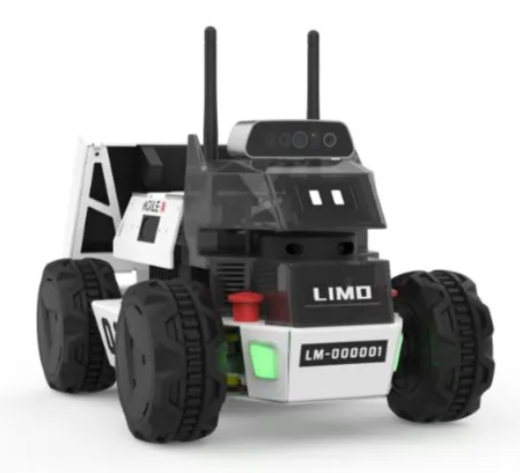

---
 
## Materiale Corso 

Troverete tutto il materiale per i laboratori su questa repository github
<p align="center"><br>https://github.com/idra-lab/ssr_lab</p>
 
Per vedere le slide scaricate quarto: <a href=https://quarto.org/docs/download/>https://quarto.org/docs/download/</a>, poi da terminale lanciate questo comando:

```bash
quarto preview slides/lezione1.qmd 
```
Che aprirà il vostro browser con le slide

---

### 📬 Come Contattarmi
- **Email:** davide.nardi-1@unitn.it
- **Post** pubblico su **moodle**

### 🕐 Orari dei laboratori

- **Lezione 1:** 19 Novembre 2026, 14:30-17:30 
- **Lezione 2:** 3 Dicembre 2026, 14:30-17:30
- **Lezione 3:** 10 Dicembre 2026, 14:30-17:30
- **Lezione 4:** 17 Dicembre 2026, 14:30-17:30

## 🎯 Obiettivi del corso

Al termine di questi laboratori sarai in grado di:

-  **Utilizzare ROS 2** — Comprendere ed utilizzare il framework ROS 2 per controllare i robot.
- **Stimare lo stato del robot (Python)** — Utilizzare i sensori per predirre lo stato del robot (posizione, orientamento, velocità, ...) in tempo reale usando i dati dei sensori (encoder delle ruote, camera, giroscopio, ...).
- **Controllare il robot (Python)** — Implementare semplici algoritmi per muovere il robot in modo autonomo.

## 📦 Cosa useremo durante il corso
- ROS2 (Robot Operating System) framework
- Visual Studio Code (IDE)
- Python programming language
- AgileX LIMO (robot mobile omnidirezionale)
- Sensori: encoder delle ruote, camera, IMU

<p align="center"><br>AgileX LIMO</p>
