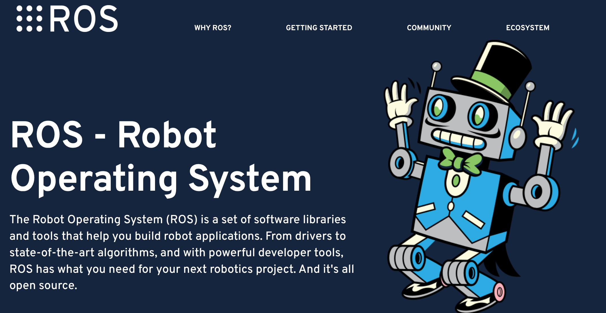
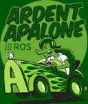
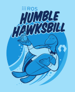
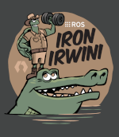
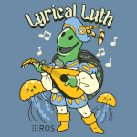
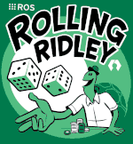
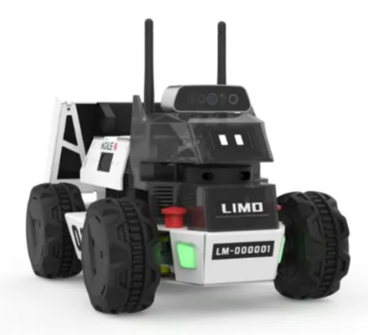

## 🎯 Obiettivi della lezione

Al termine di questa lezione sarai in grado di:

::: {.callout-tip title="Cosa imparerai" icon=true}

- 🧠 **Comprendere ROS 2** — Cos'è e a cosa serve.
- 📡 **ROS Topics** — Comprendere la comunicazione tra nodi.
- 🔄 **ROS Services** — Utilizzare il modello richiesta/risposta.
- 🔌 **Interfacciamento hardware** — Usare ROS 2 per leggere e comandare sensori e attuatori.
- 🤖 **Controllo del robot** — Muovere e controllare una **AgileX LIMO** tramite ROS 2.
:::

## 🐢 Robot Operating System 2 (ROS 2)

- **ROS 2** (*Robot Operating System 2*) è un framework **open source** per sviluppare **software robotico**.
- Funziona sopra un sistema operativo, come Linux/MacOS, e offre librerie e strumenti riutilizzabili.
- Organizza il software in **nodi** che comunicano tramite **topic**, **service** e **action**.
- Collega sensori, algoritmi e attuatori, anche su computer diversi usando la rete.




## 🐢 Evoluzione da ROS 1 a ROS 2

- **ROS 1** nasce nel 2007: Box Turtle (2010) → Indigo (2014) → Kinetic (2016) → Melodic (2018) → Noetic (2020). Utilizza un **ROS Master** centrale per individuare i nodi, che comunicano principalmente tramite **TCPROS**.

- **ROS 2** debutta con **Ardent (2017)** e introduce **DDS (Data Distribution Service)**, eliminando il Master e permettendo comunicazione distribuita, scoperta automatica dei nodi e gestione dell'affidabilità tramite **QoS**.

{height=190}

## 🐢 ROS 2 Distro: LTS, non-LTS e Rolling

- **LTS** (*Long Term Support*): Ogni 2 anni vengono rilasciate con supporto a lungo termine, cioè **5 anni** di supporto. Le distro LTS vengono rilasciate in concomitanza delle LTS Ubuntu. 
- **Non-LTS:** release stabili con circa **18 mesi** di supporto; esempi: Iron (2023), Kilted (2025). Vengono usate principalmente dagli sviluppatori per testare nuove funzionalità da introdurre nella prossima LTS.
- **Rolling Release:** aggiornamento continuo per sviluppare le distro future; può introdurre incompatibilità.

::: {style="display: flex; justify-content: space-around; align-items: flex-start; gap: 12px; margin-top: 20px; text-align: center; font-size: 0.55em;"}
<div><br>Humble (2022) · LTS</div>
<div><br>Iron (2023) · non-LTS</div>
<div><br>Jazzy (2024) · LTS</div>
<div><br>Kilted (2025) · non-LTS</div>
<div><br>Lyrical (2026) · LTS</div>
<div><br>Rolling Release<br>Aggiornamento continuo</div>
:::

::: {.notes}
La sequenza ROS 1 riporta alcune distribuzioni principali, non l'elenco completo.
Fonti: https://design.ros2.org/articles/why_ros2.html ; https://github.com/ros-infrastructure/rep/blob/master/rep-0003.rst ; https://github.com/ros2/ros2_documentation/blob/rolling/source/Releases.rst
Loghi ufficiali: https://github.com/ros2/ros2_documentation/tree/rolling/source/Releases
:::

## 🧩 ROS 2 Nodes 

- Un **ROS2 node** è un programma software che svolge un compito specifico, ad esempio leggere un sensore, calcolare un percorso o controllare i motori. 
- Un nodo riceve o invia messaggi (topic) o richieste (service) tramite la rete ROS 2.
- Ha un **nome** (es: `/limo_base`) e comunica con altri nodi tramite **topic** (es: `/cmd_vel:`), **service** e **action**.
- I nodi possono essere distribuiti su computer diversi.

```{mermaid}

flowchart LR
    planner["/planner_node"] -->|"Comando di movimento<br>topic '/cmd_vel'"| nav["/limo_base"]
    nav -->|"Dati di odometria<br>topic '/odom'"| planner

```

Comandi:
```{.bash}
ros2 node list                 # Elenca i nodi attivi: /planner_node, /limo_base
ros2 node info /planner     # Mostra le interfacce del nodo: publisher of /cmd_vel, subscriber of /odom
```

## 📡 ROS 2 Topics: Publisher e Subscriber

- Un **topic** è un canale con un nome, per esempio `/temperature`.
- Il **publisher** pubblica messaggi; i **subscriber** ricevono i nuovi messaggi.
- Più **nodi** possono pubblicare o ricevere sullo stesso topic, senza conoscersi direttamente.
- Ideale per **flussi di dati**: sensori, immagini, posizione e velocità.

```{mermaid}
flowchart LR
    sensor["temperature_node"] -->|"Misure del sensore<br>topic '/temperature'"| monitor["monitoring_node"]
    sensor -->|"Misure del sensore<br>topic '/temperature'"| recorder["recorder_node"]
```

## 📡 Topics: messaggi e comandi

- Ogni topic usa un **tipo di messaggio** standardizzato: `/temperature` usa normalmente `std_msgs/msg/Float64`.

```{.bash}
# Command line interface (CLI) per ROS 2
ros2 topic list                         # Elenca i topic
```
```{.bash}
ros2 topic info /camera_image           # Tipo e numero di publisher/subscriber
```
```{.bash}
ros2 topic echo /camera_image           # Mostra i messaggi ricevuti
```
```{.bash}
ros2 topic hz /camera_image             # Stima la frequenza ricevuta
```
```{.bash}
ros2 topic delay /camera_image          # Stima il ritardo
```

## 📨 Esempi di messaggi ROS 2

- Il **nome del topic** è scelto dall'applicazione
- Il **tipo** definisce i campi del messaggio.

::: {style="font-size: 0.65em;"}


| Topic di esempio | Tipo di messaggio | Contenuto |
|---|---|---|
| `/temperature` | `std_msgs/msg/Float64` | Un numero: `data: 23.5` |
| `/scan` | `sensor_msgs/msg/LaserScan` | Distanze e angoli del LiDAR |
| `/camera_image` | `sensor_msgs/msg/Image` | Pixel, dimensioni e codifica |
| `/imu` | `sensor_msgs/msg/Imu` | Orientamento, velocità angolare e accelerazione |
| `/cmd_vel` | `geometry_msgs/msg/Twist` | Velocità lineare e angolare |

:::


## 📨 Esempi di messaggi ROS 2

Tutti questi messaggi sono standardizzati e definiti in ROS 2, con campi specifici per ogni tipo di dato.

Potete consultare la lista di tutti i messaggi standard ROS 2 su:

- [std_msgs](https://docs.ros.org/en/jazzy/p/std_msgs/): messaggi standard (es: String, Int32, Float64, Bool, ...)
- [sensor_msgs](https://docs.ros.org/en/jazzy/p/sensor_msgs/): messaggi per sensori (es: LiDAR, camera, IMU, GPS, ...)
- [geometry_msgs](https://docs.ros.org/en/jazzy/p/geometry_msgs/): messaggi per geometria e movimento (es: Twist, Pose, Vector3, ...)
- E' anche possibile creare [messaggi personalizzati](https://docs.ros.org/en/jazzy/Tutorials/Beginner-Client-Libraries/Single-Package-Define-And-Use-Interface.html#) per applicazioni specifiche, non copriremo questa parte nel corso.
 
## 📨 Leggere la struttura di un messaggio

```{.bash}
ros2 topic type /cmd_vel                       # Mostra il tipo di messaggio del topic '/cmd_vel'
ros2 interface show geometry_msgs/msg/Twist    # Mostra come è strutturato il messaggio di tipo 'Twist'
```
L'output è
```{.bash}
Vector3  linear
	float64 x
	float64 y
	float64 z
Vector3  angular
	float64 x
	float64 y
	float64 z
```
- Come vedete ogni messaggio può essere composto da altri messaggi, come `Twist` che contiene due `Vector3` per la velocità lineare e angolare. 
- A sua volta il messaggio `Vector3` contiene tre numeri in (`float64`) per le componenti x, y e z.


## 🔄 ROS 2 Service: richiesta e risposta

- Un **service** permette di richiedere un'operazione e ricevere un risultato.
- Il **client** invia la richiesta; il **server** la elabora e restituisce una risposta.
- Il tipo di servizio definisce due strutture: **request** e **response**.
- Adatto a **operazioni brevi**, come leggere una configurazione o azzerare un contatore.

```{mermaid}
flowchart LR
    client["/planner_node"] -->|"Richiesta: {} (campo vuoto)<br>service '/start_scan'"| server["/ydlidar_ros2_driver_node"]
    server -->|"Risposta: success = true <br>service '/start_scan'"| client
```

Per inviare una richiesta (`std_srvs/srv/Empty`):

```{.bash}
ros2 service call /start_scan std_srvs/srv/Empty "{}"
```
```{.bash}
ros2 service call /stop_scan  std_srvs/srv/Empty "{}"
```

## 🔄 Service: messaggi e comandi

- Ogni service usa un **tipo di servizio** che definisce richiesta e risposta.
- Proprio come per i topic, il **nome** identifica il service; il **tipo** specifica i dati scambiati.

```{.bash}
ros2 service list                       # Elenca i service disponibili
```
```{.bash}
ros2 service list -t                    # Elenca anche i tipi
```
```{.bash}
ros2 service type /start_scan           # Mostra il tipo del service
```
```{.bash}
ros2 service find std_srvs/srv/Trigger  # Cerca per tipo (/start_scan, /stop_scan)
```


## 📨 Esempi di messaggi dei service

- La **request** contiene gli argomenti dell'operazione.
- La **response** contiene il risultato o l'esito.

::: {style="font-size: 0.65em;"}

| Service di esempio | Tipo di servizio | Richiesta → Risposta |
|---|---|---|
| `/add_two_ints` | `example_interfaces/srv/AddTwoInts` | `a: 2, b: 3` → `sum: 5` |
| `/reset` | `std_srvs/srv/Empty` | Vuota → Vuota |
| `/enable_motor` | `std_srvs/srv/SetBool` | `data: true` → `success`, `message` |
| `/trigger_capture` | `std_srvs/srv/Trigger` | Vuota → `success`, `message` |
| `/spawn` | `turtlesim/srv/Spawn` | Posizione e nome → Nome della tartaruga |

:::

I nomi sono esempi: i service disponibili dipendono dai nodi avviati.

## 📨 Tipi di servizio ROS 2

I tipi di servizio si riconoscono dal percorso **`pacchetto/srv/Tipo`**.

- [std_srvs](https://docs.ros.org/en/jazzy/p/std_srvs/): operazioni comuni (`Empty`, `SetBool`, `Trigger`).
- [example_interfaces](https://docs.ros.org/en/jazzy/p/example_interfaces/): tipi didattici, come `AddTwoInts`.
- [turtlesim](https://docs.ros.org/en/jazzy/p/turtlesim/): servizi del simulatore, come `Spawn` e `TeleportAbsolute`.
- È possibile definire **service personalizzati**, specificando i campi della richiesta e della risposta in un file `.srv`.

## 📨 Leggere la struttura di un service

```{.bash}
ros2 service type /add_two_ints
ros2 interface show example_interfaces/srv/AddTwoInts
```

L'output è:

```{.text}
int64 a
int64 b
---
int64 sum
```

- Prima di **`---`**: campi della **richiesta** (`a`, `b`).
- Dopo **`---`**: campi della **risposta** (`sum`).

## 🔄 Service: esempio pratico

Avviare il server di esempio in un terminale:

```{.bash}
ros2 run demo_nodes_cpp add_two_ints_server
```

Da un altro terminale, con l'ambiente ROS 2 caricato:

```{.bash}
ros2 service list
ros2 service type /add_two_ints
ros2 interface show example_interfaces/srv/AddTwoInts
ros2 service call /add_two_ints example_interfaces/srv/AddTwoInts "{a: 2, b: 3}"
```

Il server risponde con **`sum: 5`**. Richiede il pacchetto `demo_nodes_cpp` installato.

## ⚖️ Topic o Service?

| | **Topic** | **Service** |
|---|---|---|
| Modello | Pubblicazione / sottoscrizione | Richiesta / risposta |
| Uso tipico | Flussi di dati | Operazioni brevi su richiesta |
| Esempio | Misure del laser su `/scan` | Avvio scan su `/start_scan` |
| Risposta al mittente | Non prevista dal modello | Prevista per ogni richiesta |

Per attività lunghe con avanzamento e annullamento, come raggiungere una destinazione, si usano le **ROS action**. Le action sono una soluzione ibrida tra ROS topic e servicem ,ma non coperte in questo corso.

::: {.notes}
Fonti: [Topic](https://docs.ros.org/en/humble/Tutorials/Beginner-CLI-Tools/Understanding-ROS2-Topics/Understanding-ROS2-Topics.html), [Service](https://docs.ros.org/en/humble/Tutorials/Beginner-CLI-Tools/Understanding-ROS2-Services/Understanding-ROS2-Services.html), [Confronto delle interfacce](https://github.com/ros2/ros2_documentation/blob/rolling/source/ROS-Framework/interfaces/Topics-Services-Actions.rst).

:::

## ⚖️ Topic o Service?
- Immagini viste da una telecamera?
- Accensione di un sensore?
- Singola posizione target che il robot deve raggiungere?
- Input di controllo che il robot deve tracciare?
- Stato del robot? (Operativo/Inattivo)

## ⚖️ Topic o Service?
- Immagini viste da una telecamera? -> Topic
- Accensione di un sensore? -> Service
- Singola posizione target che il robot deve raggiungere? -> Service
- Input continuo di controllo che il robot deve tracciare? -> Topic (es: /cmd_vel)
- Stato del robot? (Operativo/Inattivo) -> Topic o Service

## 🤖 Pronti per controllare la vostra LIMO!

<p align="center"><br>AgileX LIMO</p>


