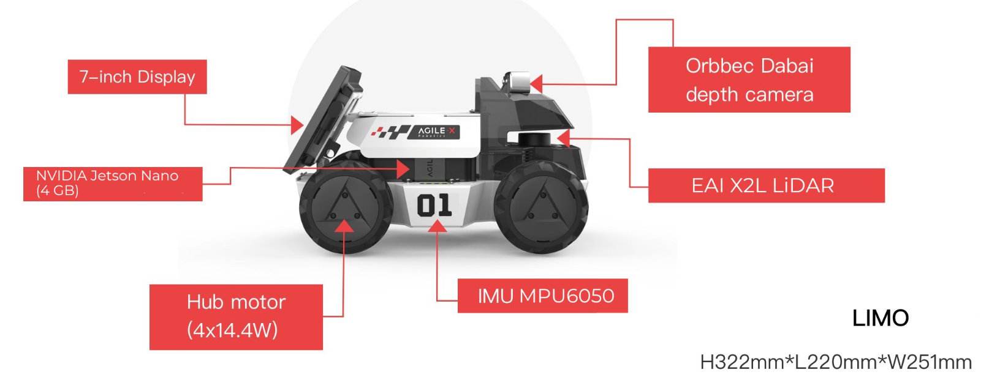
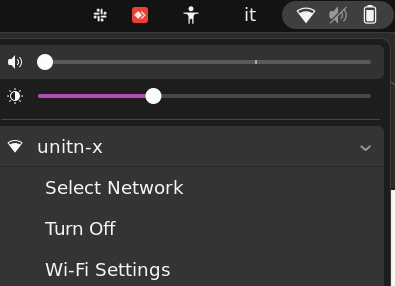
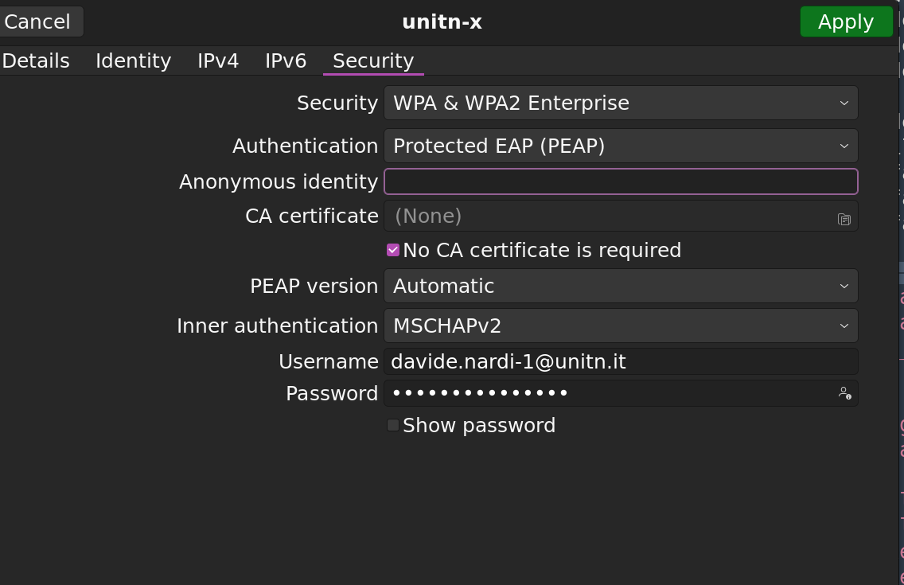
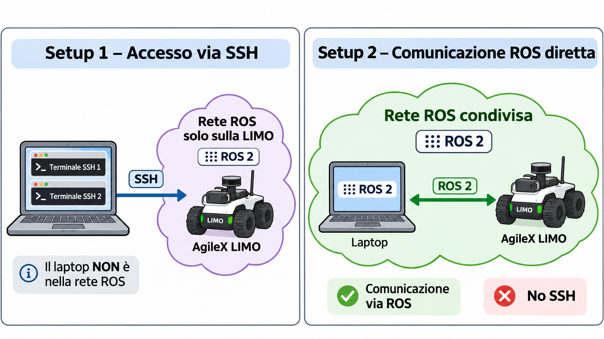
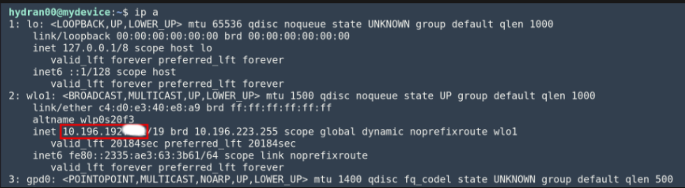
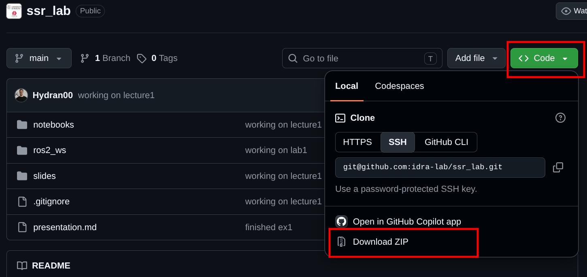

## Divisione in gruppi
- Dividetevi in 7-8 gruppi (possibilmente di grandezza simile)
- Ogni gruppo lavorerà sempre con la stessa LIMO e la stessa postazione
  

<p align="center"><br>AgileX LIMO</p>


## 🤖 AgileX LIMO: cosa c'è a bordo

<p align="center"></p>

## AgileX LIMO Setup

- Accendete la vostra LIMO premendo il tasto verde sulla sinistra
- Aprire le impostazioni di rete e connettetevi a `unitn-x` con **le vostre credenziali**: potete usare lo schermo touch e collegare una tastiera usb e/o un mouse
- Se usate il vostro laptop: assicuratevi che il dispositivo sia collegato a `unitn-x`


:::: {.columns}

::: {.column width="50%"}
{width=80%}
:::

::: {.column width="50%"}
{width=80%}
:::

::::

## Come useremo la LIMO
Per la prima lezione useremo solo la connessione SSH, dalla seconda lavoreremo in ROS dal nostro laptop
{width=80%}


## Recupero Indirizzi IP LIMO
Per poter collegarvi alla limo avrete bisogno di conoscere l'IP della LIMO

***Attenzione: gli indirizzi ip cambiano di continuo, quindi dovete annotarvelo nuovamente ad ogni utilizzo!***

*Gli IP di unitn-x sono di solito del tipo `10.196.x.y` 

:::: {.columns}

::: {.column width="50%"}
{width=100%}

Per le LIMO basta aprire un terminale per poter vedere l'indirizzo IP.
:::

::::


<!-- 
## Recupero Indirizzi IP LIMO e PC
Per poter collegarvi alla limo avrete bisogno di conoscere i seguenti ip:

- ip della LIMO
- ip del vostro computer 

***Attenzione: gli indirizzi ip di entrambi cambiano di continuo, quindi dovete annotarveli nuovamente ad ogni utilizzo!***

*Gli IP di unitn-x sono di solito del tipo `10.196.x.y` 

:::: {.columns}

::: {.column width="50%"}
{width=100%}

**Figura 1:** Per le LIMO basta aprire un terminale per poter vedere l'indirizzo IP.
:::

::: {.column width="50%"}
{width=100%}

**Figura 2:** Per il vostro pc, usate il comando `ip a` e cercate la vostra scheda wi-fi, di solito `wlan0`, `wlp2s0` o `wlo1`. In alternativa potete usare il comando "`hostname -I`".
:::

:::: -->

---

### Accedere al computer della LIMO da remoto via SSH

Possiamo accedere al computer di bordo delle Limo usando SSH (*Secure Shell*)

- Aprite un terminale sul vostro laptop/workstation

```bash
ssh agilex@<ip-limo> # nel mio caso ssh agilex@10.196.209.191
```

- Vi chiederà una password, per tutte le limo la password è "**`agx`**"


### Preparare l'ambiente ROS (sulla LIMO)

Dopo l'accesso in ssh, dalla home  (`~/`) eseguite il file `setup.sh`

```bash
source setup.bash             # esegui il file setup.bash
```

Se non siete nella home
```bash
cd                            # (change directory) -> vai alla home, equivalente a cd $HOME
source setup.bash             # esegui il file setup.bash
```

**Vi verrà chiesto di inserire il numero della vostra LIMO e l'IP del vostro PC: inserite i dati richiesti. (Nella lezione 1 potete ignorare, premendo solo invio dato che non useremo ROS sul nostro laptop)**

*Questo script imposterà delle variabili di ambiente che assicurano che solo voi possiate comunicare con la vostra LIMO tramite ROS.*

## Lanciate il nodo ROS della LIMO

Un `ROS launch file` è un file python che permette di lanciare diversi nodi ROS assieme, con un unico comando.

Avviate il `launch file` dal terminale della LIMO.
```bash
ros2 launch limo_bringup limo_start.launch.py # va sempre eseguito dopo `source setup.bash` spiegato nella slide precedente
``` 
Questo launch file avvia diversi Nodi ROS:

- il controllore di basso livello per muovere la macchinina
- i vari nodi dei sensori (lidar, IMU, depth camera, motor encoder)


**Potete verificare se funziona tutto aprendo un nuovo terminale (via SSH) e digitando**

```bash
source setup.bash 
ros2 topic list # vi mostrerà diversi topic pubblicati dalla macchinina
```
Potete anche vedere i ROS node attivi o i ROS service attivi
```bash
ros2 node list
```

```bash
ros2 service list
```


## Preparare l'ambiente ROS (sul vostro PC) - Solo per lezioni 2+

- Dal vostro pc con Ubuntu 24.04 e ROS2, scaricate la repository del corso

<p align="center"><br>https://github.com/idra-lab/ssr_lab</p>

- Fate l'unzip della cartella e mettetela sulla vostra Home (`~/ssr_lab`)
- Copiate lo script in `~/ssr_lab/utils/host/setup.sh` sulla vostra home
```bash
cp ~/ssr_lab/utils/host/setup.sh ~/  # cp copia da destinazione (primo argomento) a target (secondo argomento)  
```

## Muovere la macchinina

Dato che il nodo della LIMO è già attivo, possiamo provare a usare il topic `/cmd_vel` per comandare una velocità usando l'utility `ros2 topic pub` per pubblicare comandi da terminale.

```bash
ros2 topic pub -r 10 /cmd_vel geometry_msgs/msg/Twist "linear:
  x: 0.05
  y: 0.0
  z: 0.0
angular:
  x: 0.0
  y: 0.0
  z: 0.2" 
```